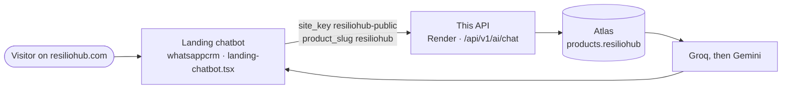
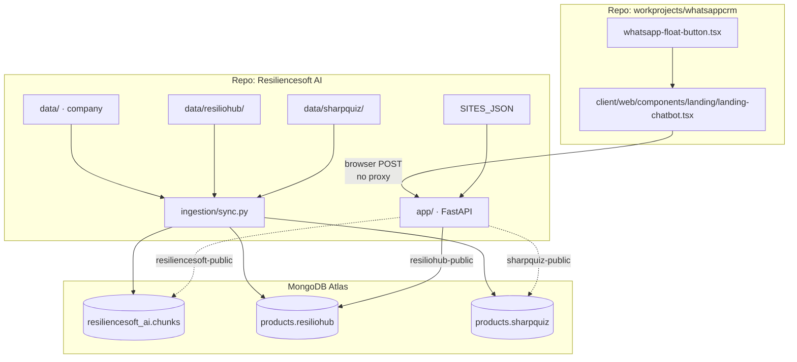
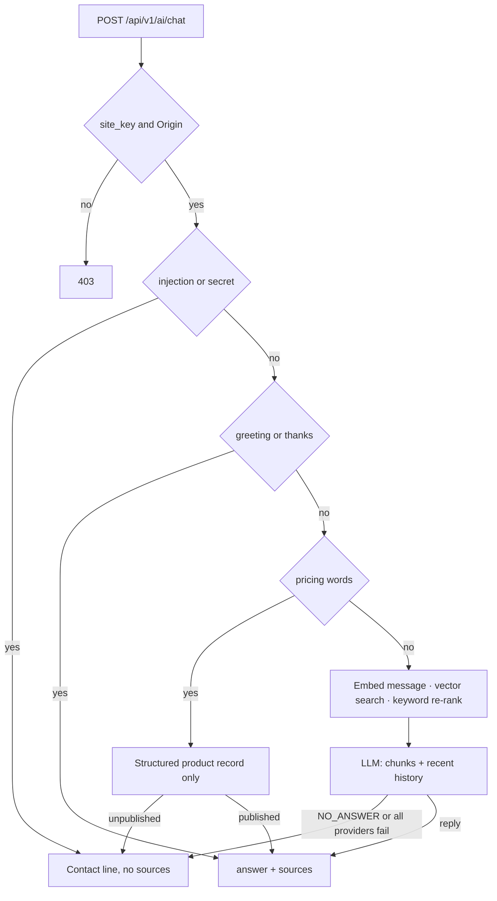
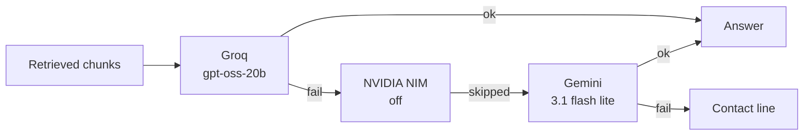
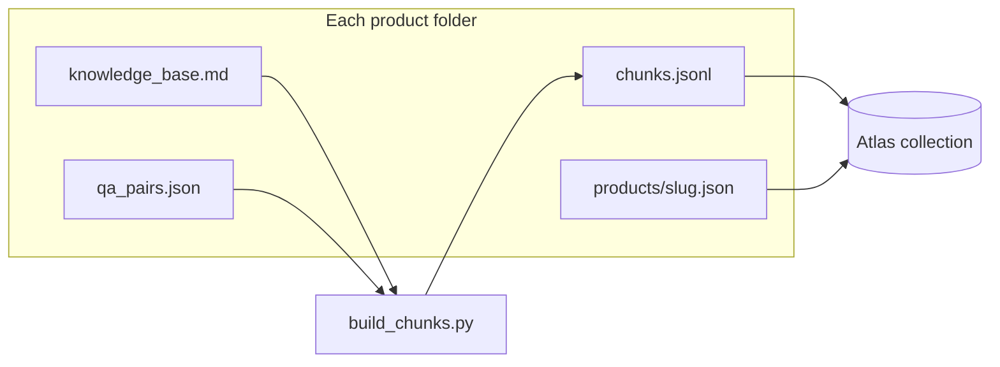

# Resiliencesoft AI — Central AI Knowledge Engine

One knowledge engine for ResilienceSoft and its products. Public sites ask a question. The API retrieves only that site's approved knowledge and answers from those chunks. It does not invent prices or features.

Live service: `https://resiliencesoft-ai-rag.onrender.com` (Render name `resiliencesoft-ai-rag`, `render.yaml`).



Sharp Quiz and the company site are the same API with a different key. They are drawn under [Where things live](#where-things-live).

## Where things live

This repo is the engine and the knowledge. The chat widget is not here.

| What | Where |
|---|---|
| This API, retrieval, providers, security | `app/` |
| Company copy (ResilienceSoft) | `data/knowledge_base.md`, `data/qa_pairs.json`, `data/chunks.jsonl` → Atlas `resiliencesoft_ai.chunks` |
| ResilioHub copy and pricing record | `data/resiliohub/` → Atlas `products.resiliohub` |
| Sharp Quiz copy and pricing record | `data/sharpquiz/` → Atlas `products.sharpquiz` |
| Which site key may call, and from which Origin | `SITES_JSON` in `.env` (shape in `.env.example`) |
| Deploy | `render.yaml`. Start runs `python -m ingestion.sync`, then Uvicorn. |
| ResilioHub landing chatbot (only wired client) | `workprojects/whatsappcrm/client/web/components/landing/landing-chatbot.tsx`, opened from `whatsapp-float-button.tsx` |



Solid line is the only client wired today. Dashed lines are the same API, unused by the landing widget.

The landing widget is a static Next export. It calls Render from the browser. It cannot proxy.

What that widget sends:

- `site_key`: `resiliohub-public`
- `message`: the visitor's question only, so search stays on the question
- `page_context`: `{ url: location.href, product_slug: "resiliohub" }`
- `history`: recent turns, plus any tone notes that landing page wants the model to see

Each `site_key` searches only that site's collection. A ResilioHub call does not open Sharp Quiz or the company collection. Videos, booking, and product voice belong to the landing page that calls this API, not to this service. Greetings get a short generic reply. Facts still come from retrieved chunks, or the contact line when the chunks do not contain the answer.

Browser Origins allowed for ResilioHub: `https://resiliohub.com`, `https://www.resiliohub.com`, `https://staging.resiliohub.com`, and `http://localhost:3000`. Any other Origin gets `400` on the preflight (`Disallowed CORS origin`).

## What we are doing

Each public site gets its own `site_key`. The key picks a site, an Origin allowlist, and a `public` scope.



A chat call then:

1. Rejects unknown keys and Origins that are not on that site's list.
2. Rate-limits by IP (`RATE_LIMIT_RPM`, default 30).
3. Drops prompt-injection attempts and any chunk or answer that looks like a secret.
4. Answers pricing questions from the structured product record only. If pricing is unpublished, it tells the visitor to contact the company. The model never guesses a price.
5. Greetings, thanks, and "what can you do" get a short reply without a search. The wording is not tied to one product.
6. Other messages search that site's chunks. `page_context.product_slug` keeps hits on that product and on `general` chunks.
7. The model sees those chunks plus the recent conversation. The server does not store the thread. Each browser sends its own `history`, capped at 6 turns and 2400 characters, so concurrent visitors cannot see each other. Groq allows a 131072-token window. This free Render instance is 512 MB and 0.1 CPU, and the embedding model already uses that RAM, so the cap stays small.

Sites in `SITES_JSON` today:

| site_key | Knowledge | Typical page |
|---|---|---|
| `resiliencesoft-public` | Company site | resiliencesoft.com |
| `resiliohub-public` | ResilioHub | resiliohub.com |
| `sharpquiz-public` | Sharp Quiz | sharpquiz.com |

A ResilioHub call does not search Sharp Quiz or the company corpus. Those live in other collections and need their own `site_key`. Pass `product_slug` (for example `resiliohub`) so retrieval stays on that product.

## What we are using

| Piece | Choice |
|---|---|
| API | FastAPI, Uvicorn, Pydantic |
| Database | MongoDB Atlas. Company chunks in `resiliencesoft_ai.chunks`. One collection per product in the `products` database (`resiliohub`, `sharpquiz`). |
| Embeddings | fastembed, `BAAI/bge-small-en-v1.5`, 384 dimensions, cosine |
| Retrieval | Atlas Vector Search (`chunks_vector`) plus an in-collection keyword scan, merged with reciprocal rank. Top 5, minimum vector score 0.55. |
| LLM | Groq (`openai/gpt-oss-20b`), then Gemini (`gemini-3.1-flash-lite`). NVIDIA NIM (`nvidia/nemotron-3-super-120b-a12b`) is in the chain but off (`NIM_ENABLED=false`) until it has a production license. |
| Fallback | Per-provider timeout 15s, one retry on 429/5xx, overall deadline 30s. Order: `groq,nim,gemini`. |


| Host | Render free web service, Python 3.12. Start command syncs knowledge, then serves. |

## Knowledge in the repo



```
data/                      ResilienceSoft company site
data/resiliohub/           ResilioHub
data/sharpquiz/            Sharp Quiz
  knowledge_base.md        source copy
  qa_pairs.json            one chunk per pair
  chunks.jsonl             retrieval chunks
  products/<slug>.json     structured record (pricing, contact)
```

`python -m ingestion.sync` loads those three folders. Unchanged chunks are skipped, so a code-only deploy does not re-embed. `ingestion/crawl_site.py` is an optional same-site crawler (`robots.txt`, 0.5s delay). It needs BeautifulSoup and is not part of the API runtime.

## Run

```bash
cp .env.example .env   # fill MONGODB_URI, provider keys, SITES_JSON
uv venv && uv pip install -r requirements.txt
python -m ingestion.build_chunks
python -m ingestion.ingest --indexes      # once; wait for Atlas to build indexes
python -m ingestion.sync
python -m eval.run_eval
uvicorn app.main:app --reload
```

## API

`POST /api/v1/ai/chat`

```json
{
  "site_key": "resiliohub-public",
  "message": "How do I connect a WhatsApp number?",
  "page_context": { "url": "https://resiliohub.com/", "product_slug": "resiliohub" },
  "history": []
}
```

Response: `{ "answer", "sources": [{ "title", "url" }], "request_id" }`.

Send `Accept: text/event-stream` to receive the same answer as server-sent events: `delta` text chunks, then `done` with the full answer and sources. If the model has no fact, or a secret check fails after tokens already went out, a `replace` event swaps in the contact line. Clients that omit that header still get one JSON object. The browser `Origin` must be on that site's allowlist. `message` max 1000 characters. Each history item max 2000 characters, role `user` or `assistant`. The ResilioHub landing widget is the client that sends this body. See [Where things live](#where-things-live).

- `GET /api/v1/ai/products/{slug}?site_key=...` — structured product record for that site
- `GET /health`

## Modules

- `app/rag_engine` — embed, hybrid retrieval, grounded prompt
- `app/llm_gateway` — provider order, timeout, retry
- `app/security` — site key, Origin allowlist, rate limit, secret and injection checks
- `ingestion` — chunk build, Atlas ingest, deploy sync
- `eval` — retrieval keyword checks (`eval/run_eval.py`) and chat checks (`eval/run_chat_eval.py`)
